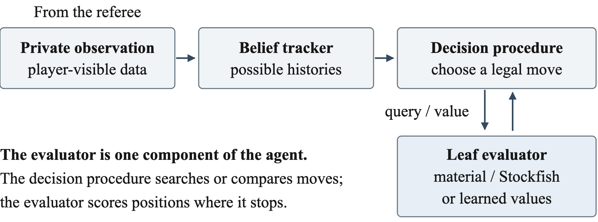

# Improving and Exploring Value Prediction for Simplified Partially Observable Chess

Fog of War Chess with Sampled Beliefs

CS4246/CS5446 Reinforcement Learning and Sequential Decision Making

National University of Singapore School of Computing

Semester 1 AY2026/27

14 November 2026

DING Chiyu; PEI Shengxin; QUEK Hongqiang Colin; KUAH Jun Hong Bryan; WANG Zhijian; LIN Tzu-Chun.

---

## Abstract

Fog of War chess hides the opponent's pieces, so a player must act on a belief rather than a known board. Against a fixed opponent this is a partially observable Markov decision process (POMDP), whose optimal play requires values over beliefs. Exact solution is out of reach, so we study a common approximation: a rule-based tracker supplies boards consistent with the player's observations, and decisions use values of those boards as if each were fully observed (QMDP-style). We ask whether reducing value-prediction error improves decisions. A learned correction to depth-1 Stockfish (Network 1) cuts error against depth-11 Stockfish by 20%, yet no improvement is established in the value lost by chosen moves or in game score; a linear correction recovers most of the gain. Models trained on game outcomes with Monte Carlo and temporal-difference targets predict results better but choose moves of lower deep-engine value, and belief context improves prediction without an established game gain. In the search planner, Network 1 scores 46.59% (95% interval 36.36%–56.82%) against the same planner using depth-1 values; a network trained on search labels did beat piece values there. Average value error alone is insufficient to establish decision quality.

## 1 Introduction

Fog of War chess keeps the moves of chess but hides information. Each player sees only their own pieces and the squares those pieces can reach, and a game is won by capturing the opponent's king. One view can be consistent with several hidden positions in which the same move is safe in one and loses the game in another [1]. The game is a clean test bed for our question: the rules are exact and strong full-information evaluators exist, so value estimation can be studied in isolation. The strongest published agents treat the game as a two-player imperfect-information game and combine subgame solving with large-scale search [2, 3].

Fixing the opponent turns this game into a POMDP for our player: optimal play needs a value function over beliefs, which is intractable here because beliefs range over very large sets of hidden histories [4, 5]. We therefore study a standard approximation. A rule-based tracker computes the boards consistent with the player's private observations, and decisions use values of sampled boards as if each were fully observed. Our one-ply planner averages these values, a QMDP-style approximation [6] related to determinization, or perfect-information Monte Carlo search [7, 8]. Our search planner instead solves a sampled imperfect-information subgame and uses full-board values only at its frontier [2, 3].

Search with learned values at its frontier underlies strong game agents [9-11], and in both planners value estimation is the bottleneck. Deep engine search gives accurate values but is slow: in our matches, depth-11 Stockfish takes about 220 times as long per move as depth 1. We ask: RQ1, does a learned correction that reduces the error of cheap depth-1 values also improve move selection and game score? RQ2, how do the training target (deep-engine values versus game outcomes) and belief context change what the value function learns? RQ3, does a stronger search planner change these conclusions?

We contribute a Fog of War environment with private observations and consistency tracking, interchangeable value functions, two search planners and audited match records [12-14]. Our main finding is that a substantial reduction in average value error did not yield an established decision improvement, and we analyse why.

## 2 Problem formulation

### 2.1 Fog of War chess as a POMDP

The referee state s_t comprises piece placement, side to move, castling and en-passant rights, clocks and repetition history. After each ply a player receives a private observation o_t: its own pieces, the squares they can reach with their contents (including visible emptiness), its legal actions when it is to move, notice of captured own pieces and the game result. Unseen squares are unknown, not empty, and legal actions are themselves evidence.

Fog of War chess is a two-player zero-sum imperfect-information game. Against a fixed opponent mechanism, it induces for our player a POMDP (S, A, T, O, R) [4, 5], extending the course's MDP formulation to hidden state [15]. A contains our legal moves; T applies our move and then the opponent's response; O gives our private feedback; R is +1/0/-1 at the end of the game, without discounting. If the opponent keeps private memory, that memory belongs in the hidden state. With e_t denoting our history of observations and own actions, the belief b(s) = P(s | e_t) is updated by b'(s') = η O(o' | s', a) Σ_s T(s' | s, a) b(s), where η normalizes [4]. Optimal play maximizes a value function V*(b) defined over beliefs; for a single decision this is the maximum-expected-utility principle applied to a belief [16]. A masked board is not a Markov state: earlier evidence changes which hidden positions remain possible. Our experiments always face a fixed opponent, so this formulation describes them. When the opponent's strategy is not fixed but part of the problem, the task is the original two-player game, or partially observable stochastic game, whose strongest agents compute equilibrium strategies [3, 17, 18].

### 2.2 Our approximation: sampled beliefs and full-board values

The search tracker enumerates the histories that the rules allow given e_t. Untruncated, this set contains the support of the belief, and equals it only if the opponent gives every legal move positive probability. It then samples K histories uniformly, giving an empirical belief b_hat(h) = (1/K) Σ_k 1[h = h_k] whose support is generally a subset of that set. The approximations are finite sampling, the pruning and reconstruction of Section 3, and uniform weighting, which ignores how likely the opponent was to choose each move and so is not the Bayesian posterior.

The one-ply planner chooses the move a maximizing Σ_h b_hat(h) V_full(h after a), the belief-weighted value of the successor boards. This is QMDP-style rather than standard QMDP [6], which weights the action values of the fully observed fixed-opponent MDP; V_full instead estimates perfect-information chess values that assume strong play by both sides. Like QMDP and determinization [7, 8], it is cheap but assumes the uncertainty disappears after the move, so it does not credit the extra future value of information-gathering moves (which may still be chosen for other reasons), and determinized search can assume different follow-ups in boards the player cannot tell apart (strategy fusion) [7, 8]. The search planner differs: it groups sampled histories into information sets and computes one strategy per set with PCFR+, so its tree represents what the player will know, and only its frontier scores single boards with V_full [2, 3]. In both planners, decision quality depends on how well V_full ranks the boards that matter for the choice. Both planners thus sit between an MDP and the full POMDP: beliefs are tracked, but frontier values are those of fully observed boards.

### 2.3 Value functions and search

Our value functions V_full score full boards from the moving player's perspective in [-1, 1]: piece values, Stockfish 19 at depth 1 (D1, fast) and depth 11 (D11, slow), and learned corrections of D1 toward D11. Beyond one-ply lookahead, a second planner runs predictive counterfactual regret minimization (PCFR+) on a growing tree over sampled hypotheses, adapting knowledge-limited subgame solving [2, 3]. Like DeepStack and ReBeL [10, 11], and like the value-network leaves that replace rollouts in AlphaGo Zero-style search [9], it relies on values at the search frontier, but without their guarantees for our sampled trees and full-board labels. Predicting values (passive learning) and choosing actions (control) are distinct problems [15]; whether better prediction delivers better choices is our central question.

### 2.4 Why this approach rather than a POMDP solver

A POMDP solver is the natural alternative. Offline point-based solvers such as SARSOP compute policies over the reachable belief space [19], and online solvers such as POMCP and DESPOT search from the current belief with sampled particles [20, 21]. All need a model of the opponent, because its reply is part of T, and their guarantees hold only for that model. Offline solvers also need the states enumerated, which is not practical for hidden chess histories. An online solver could use a simulator that carries the opponent's private observations and memory, but we did not build and validate one. A policy that is optimal against one assumed opponent can be exploited by another, because the underlying problem is a two-player zero-sum game [17, 18], and the strongest published Fog of War agents handle this strategic uncertainty with game-theoretic subgame solving, without committing to one response model [2, 3]. We adopted that approach for the search planner and kept the one-ply planner as a cheap controlled baseline in which only the value function changes. This is a design choice, not a claim that POMDP solvers cannot be applied: we ran none, and neither planner performs exact posterior inference or solves the induced POMDP.

Both planners need values for positions they cannot search to the end. Deep engine values are accurate but costly, so cheap learned values are where the course's learning methods apply (Table 1), and their effect on decisions is what this report measures. The approach suits that question: the tracker and the planner stay fixed, so a change in decisions can be attributed to the value function.

**Table 1.** Course methods and their role in this project.

| Course method | Role in this project | Applied directly or substituted |
|---|---|---|
| Maximum expected utility with beliefs (Week 3) [16] | Choose the move with the best belief-weighted value | Applied, with sampled boards as the belief and full-board values as utilities |
| MDPs and Bellman equations (Week 4) [15] | Basis of the POMDP formulation (Section 2.1) [4, 5] | Exact POMDP solution not attempted (Section 2.4); QMDP-style averaging and PCFR+ search instead |
| MC, TD(0) and TD(λ) prediction (Week 4) [15] | Value targets from recorded game outcomes (Section 4.2) | Applied offline as prediction; no online self-play control loop was completed |
| Value-function approximation, semi-gradient TD (Week 5) [22] | Linear correction, Network 1, belief network, MC/TD models | Applied |
| Rollouts, MCTS and value-network leaves (Week 7) [9] | Learned values at the search frontier | Leaf evaluation applied; information-set search instead of MCTS over determinized boards, which risks strategy fusion [7] |
| Learning from an expert (Week 7) [9] | Distil depth-11 Stockfish into cheap value functions | Applied to values rather than to a policy |
| Zero-sum imperfect-information games (Week 10) [17] | PCFR+ computes mixed strategies over information sets | Local, budgeted subgame solving on sampled trees, without an equilibrium guarantee |

## 3 System

A referee holds the true board. Each agent receives only its private observations and its own actions, and its value functions see only boards inferred from them; offline labels and post-game diagnostics use separately recorded complete positions [12]. Visibility follows the Fog of War rules, kings can be captured, and rule-decided positions are scored before any engine or network call; fixtures test visibility, castling, en-passant and draw cases.

Two trackers implement the belief approximation of Section 2.2. The search tracker starts from the public initial position, applies our known moves, enumerates every possible opponent move, regenerates the feedback each would produce and keeps only matching histories. To bound memory, the version used in the search batch keeps at most 8192 uniformly chosen histories after each update and, if later evidence eliminates them all, replays the full private observation stream to recover. Pruning can drop the true history and recovery can fail (Section 6.5) [23]. The one-ply experiments instead use a 256-particle tracker that relocates hidden pieces to fit current feedback without certifying the complete past. Training beliefs for the belief network are synthetic: hidden pieces are relocated consistently with the generating observation, without requiring a legal complete history [13].

**Figure 1.** Private evidence feeds tracking and decision making; a value function scores the frontier. Both planners share this boundary, but swapping value functions does not equalise computation [12, 13].

Value functions receive boards in a shared 32-plane encoding: 12 piece, four visibility, seven belief-summary, three context and six rule-state planes. Belief summaries are occupancy marginals of the sampled boards, not a joint posterior, so the encoding is not a sufficient statistic of the belief. Network 1 uses the 19 board planes plus the D1 score; the belief network uses all 32 [13].

The search planner builds a game tree over the sampled histories (our moves, then the opponent's replies) and solves it with PCFR+, a regret-minimisation method. At each information set it keeps the accumulated regret for not having played each action and plays actions in proportion to positive regret, using the previous round's utilities as a prediction. Repeated rounds for both players move the strategies toward an equilibrium of the tree. Between stages the tree grows by one ply while solver state is kept, under node, evaluator-call and time budgets, and the move is sampled from the final strategy. The search batch uses this uniform-growth anytime mode rather than every optional mechanism [12]. Budgets are cooperative rather than hard deadlines, and earlier pilots exposed long-game tracking failures [24]. Each experiment retains the rules and source revision it was run with [12, 14].

## 4 Learned leaf evaluation

### 4.1 Data and targets

D1 and D11 (quick and careful Stockfish in the tables) use Stockfish 19. Values use the acting-player perspective in [-1, 1]: tanh(c/600) for centipawns c, and ±1 for forced mate [13].

When these data were generated, no search-based labels existed (they came later; Section 6.6). We sampled four parents from each of 8,000 ordinary-chess practice games mixing Stockfish and random moves. MultiPV scores child moves together; Fog-rule checks override rule-decided positions.

A hash of game identity assigns 80% of games to training, 10% to validation and 10% to a sealed test bucket. The reported check set is a separate generation with a different seed: 959 games, 3,818 decisions and 94,963 eligible children after excluding rule-decided children. It also helped compare three Network 1 candidates, so the reported measurements are development results, not a sealed-test estimate [13].

### 4.2 Evaluators and learning targets

Material uses weights 1/3/3/5/9. The learned evaluators correct the D1 value d of a board s and are trained toward D11. The linear correction has 1,217 inputs x (19 planes of 64 squares, and d) and an L2 penalty on w. Its plain form is v = clip(d + w·x + b) and its bounded form is v = tanh(atanh(d) + w·x + b), with d clipped inside (-1, 1). Network 1 replaces the linear term with a residual convolutional network f of 521,425 parameters, v = tanh(atanh(d) + f(s, d)): a 3×3 convolution with 64 channels, six residual blocks and a small head, whose last layer starts at zero so that training starts from D1 itself. It minimises squared error on 638,451 positions with AdamW (learning rate 0.002 with cosine decay, batch size 512), keeping the epoch with the lowest validation error. All still incur the D1 engine call [13].

The 562,000-parameter belief network uses the same residual trunk on all 32 planes and also corrects the D1 value. It turns each board into a 128-number embedding and appends the weighted mean embedding of all boards in the belief before the value head, so a board's value can change with the belief. Its practice labels, however, are each board's belief-independent careful-Stockfish value, on the synthetic beliefs of Section 3 [13].

We also train the bounded linear model on game outcomes. Let z_t be the final result from the view of the player to move at step t. Monte Carlo (MC) uses the target y_t = z_t. TD(0) uses y_t = -v(s_{t+1}), with the sign changed because values follow the side to move, and y_T = z_T at the last position. TD(λ), with λ = 0.8, uses the λ-return, a weighted mix of the n-step targets. These are fitted prediction experiments using recorded trajectories, with semi-gradient targets and up to 15 TD rounds. They do not implement an online policy-improvement loop [22, 25].

## 5 Evaluation method

### 5.1 Offline metrics

Mean absolute error measures agreement with D11. Same top move allows teacher ties; value lost is best eligible sibling teacher value minus the chosen move's teacher value. Evaluator ties use UCI order [13]. Paired differences use 2,000 bootstrap resamples of whole games to preserve within-game dependence.

### 5.2 Archived one-ply matches

Each candidate faces the D1-evaluator agent on 100 random openings of two to eight plies, repeated with colours swapped. The D1 agent, like every agent, receives only private observations and tracked hypotheses. Win/draw/loss scores are 1/0.5/0; averages use complete colour pairs. This protocol counts a 200-ply cap as a draw [14, 26].

Evaluator agents share one-ply planning with 256 particles and K = 8 sampled boards, but total work differs; latency excludes tracking, and Stockfish uses one thread and a 16 MB hash.

The one-ply batch ran on 26–27 October with an earlier rule implementation, before later draw-rule fixes, so its seven comparisons are kept separate from later games [14, 26].

### 5.3 Later search comparison

We schedule 50 colour pairs (seeds 1001–1050) of the search agent using Network 1 against the same agent using D1. Both use four hypotheses, depth 1 growing to at most 2, 16 solver rounds, 4096 nodes and 128 evaluator-call caps. Search allows five cooperative seconds; bounded-history tracking separately allows 60 seconds and eight replays. Equal caps imply neither equal work nor a hard turn deadline. The 200-ply diagnostic cap is unscored; only jointly clean terminal pairs contribute to score, while failures remain separate [27].

Tracking and Stockfish run on CPU and Network 1 on a laptop GPU; the archive pins code, configurations, checkpoint and engine versions [27].

## 6 Results

### 6.1 Lower value error without an established gain in move choice

**Table 2.** Development check against D11: 94,963 eligible children, 3,818 decisions, 959 games. Cost: median CPU time per parent's children, separately timed on 300 parents [13].

| Evaluator | Value error | Same top move | Value lost | ms per parent |
|---|---|---|---|---|
| Piece values | 0.336 | 27.7% | 0.2108 | 0.6 |
| Quick Stockfish | 0.095 | 42.9% | 0.0355 | 1.4 |
| Linear correction | 0.084 | 41.5% | 0.0346 | 1.7 |
| Linear inside tanh | 0.079 | 43.5% | 0.0348 | not timed |
| Network 1 | 0.076 | 42.4% | 0.0352 | 12.2 |

Network 1 reduces error about 20%: paired difference -0.019, 95% interval [-0.021, -0.018]. Value-lost difference is -0.0003 [-0.0017, +0.0011]; neither improved selection nor equivalence is established. Figure 2 breaks the error down by position category; Section 7 discusses why this matters.

Linear correction captures 56% of Network 1's error reduction, or 83% with bounded parameterization. Network 1 costs nine times D1 on CPU; on a laptop GPU it takes 4.4 ms per parent, still three times D1.

**Figure 2.** Development error by teacher assessment. Corrections improve decided positions but worsen close ones; bin definitions and analysis remain archived [13].

### 6.2 The training target determines what the value learns

Distillation fits 638,451 child rows from 6,414 training games. MC and TD drop 175 unfinished training games and use 722,500 trajectory positions from 6,239 finished games, so the training rows also change. MC and TD never receive careful Stockfish's values [25].

**Table 3.** Bounded linear model, different targets. Teacher population: Table 2. Outcome MSE uses 106,971 positions from 929 finished check games (32 unfinished excluded) [25].

| Training target | Value error | Outcome MSE | Same top move | Value lost |
|---|---|---|---|---|
| Careful Stockfish | 0.079 | 0.513 | 43.5% | 0.0348 |
| Game result with MC | 0.217 | 0.481 | 38.6% | 0.0505 |
| TD(0) | 0.185 | 0.476 | 42.1% | 0.0370 |
| TD(λ) with λ = 0.8 | 0.208 | 0.476 | 41.5% | 0.0415 |
| Quick Stockfish alone | 0.095 | 0.497 | 42.9% | 0.0355 |

Outcome-trained models predict practice returns better but agree less with the teacher and choose moves of lower teacher value. TD(0)'s outcome MSE improves over MC by 0.0053 [0.0010, 0.0097]. Predicting a weak, partly random policy's returns differs from approximating stronger continuation play.

Both TD methods reach 15 rounds. A 40-round diagnostic barely changes outcome MSE and worsens teacher error; the cap alone does not explain the gap. This result is for one dataset and one model and does not show that outcome-based RL is inferior in general [25].

### 6.3 Belief context improves prediction, not demonstrated decisions

On 3,818 synthetic check beliefs, the belief network reduces board error from quick Stockfish's 0.080 to 0.074 and weighted-belief error from 0.055 to 0.047. That difference is -0.008 [-0.009, -0.007], resampling 959 source games. Across five training seeds, mean board error is 0.0734 with context and 0.0762 without it; every seed improves [13].

Each board's target is belief-independent. Context can denoise predictions without learning information's strategic value: different beliefs may require different strategies despite the same board label. Establishing strategic value needs belief-dependent labels, such as those in Section 6.6, and action comparisons.

### 6.4 Game outcomes with one-ply lookahead

**Table 4.** Against D1, 200 games per row. Scores and intervals use complete colour pairs (100 per row, 99 for random). W/D/L counts all finished games. Cost is the candidate's median decision latency, excluding tracking [14, 26].

| Evaluator | Score | Bootstrap 95% | Wilson 95% | W/D/L | ms per move |
|---|---|---|---|---|---|
| Quick Stockfish | 0.520 | 0.455-0.588 | 0.423-0.615 | 103/2/95 | 11.1 |
| Random moves | 0.000 | withheld | 0.000-0.037 | 0/0/199 | 0.005 |
| Piece values | 0.048 | 0.023-0.078 | 0.020-0.108 | 9/1/190 | 4.3 |
| Linear correction | 0.513 | 0.455-0.573 | 0.416-0.608 | 98/9/93 | 14.2 |
| Network 1 | 0.515 | 0.448-0.585 | 0.418-0.611 | 100/6/94 | 36.1 |
| Belief network | 0.563 | 0.495-0.630 | 0.465-0.656 | 111/3/86 | 149.8 |
| Careful Stockfish | 0.585 | 0.513-0.660 | 0.487-0.677 | 114/6/80 | 2,452 |

One random-row game failed when quick Stockfish's tracker found no consistent board; its partner counts in W/D/L only, and random's bootstrap is withheld because every complete pair scores zero. Six draws reached the 200-ply cap; all others were repetitions.

The random and piece-value controls score poorly, and quick Stockfish against itself includes 0.5 as expected. No gain is established for Network 1 or the linear correction, and the belief network's intervals include 0.5. Careful Stockfish's bootstrap interval narrowly excludes 0.5, but its Wilson interval includes it, and adjusting for seven comparisons removes the nominal finding. These are separate matches against D1, not a head-to-head ranking. The belief network receives one board at a time, so its row does not test whole-belief context.

### 6.5 Game outcomes with search

All 100 planned games were attempted: 93 reached a terminal result and seven failed, with none capped, missing or unplayed. Failures affected six pairs, leaving 44 clean pairs (88 games). On those pairs, Network 1 recorded 41 wins, 47 losses and no draws: a paired score of 46.59%, with a whole-pair bootstrap (20,000 resamples) 95% interval of 36.36%–56.82%. It establishes neither a Network 1 advantage nor statistical equivalence [27].

Failures (four replay-support losses, two update timeouts and one pruning timeout) remain in the archive, and the estimate conditions on joint completion. Six of the seven failures occurred in the D1-leaf agent's tracker; scoring all 93 terminal games gives 46.24% [27].

The random and piece-value controls of Table 4 set a performance floor for the older one-ply system, not for this search batch. Neither study compares our search to a POMDP-optimal agent, the published Obscuro agent, or one-ply under matched whole-turn compute. We therefore report measured baseline-relative performance, without claiming published strength or a search-algorithm advantage.

### 6.6 A search-trained value network

A later lane of the project, outside the controlled comparisons above, trained value networks on labels from the search planner itself: a depth-8 Stockfish frontier searched over 16 sampled boards, so each label depends on the belief. Two label rounds produced 480 games and 22,771 labelled positions, with 35 games lost to tracking or engine failures [28]. The resulting value network v2 needs no engine call and is distinct from Network 1 and the belief network. The checkpoint used in play, trained on 196 games of the first of these rounds, has position error 0.232 against these labels on that round's 25 validation games, versus 0.286 for piece values and 0.114 for depth-1 Stockfish 14.1: a 19% reduction over piece values, similar in relative size to Network 1's gain over D1, although the labels differ. The belief matters as an input: a network that sees only the player's own view has position error 0.400, against 0.246 with the 16 sampled boards (difference +0.154 [+0.109, +0.200]). In play the network scores one board at a time, so these are not the errors of the leaf as used. Inside the same search, with the same clock and tracker on both sides, the v2 leaf beat the piece-value leaf 77-0-11 over 88 completed games (ten failed, two not played): score 0.875, game-level Wilson 95% interval 0.790–0.929. The opponent uses the weakest leaf, and the code state is recorded by per-file hashes rather than one commit, so this is supporting evidence, separate from Section 6.5 rather than a contradiction of it. Self-play games with v2 as the leaf (381) were collected but not yet trained on, so no iterative improvement loop was completed [28].

## 7 Discussion and limitations

Why did better predictions not give measurably better moves? In the one-ply planner a move is chosen by comparing averaged successor values, so only errors that change the ranking of candidate moves matter. Learned corrections improve decided positions, where rankings rarely change, but slightly worsen close positions, where they can (Figure 2). Mean absolute error spreads its weight over positions that rarely affect decisions. Section 6.6 points the same way from the other side: a similar relative error reduction over piece values did change results inside search. This matches the course's model-based lesson that useful models must preserve decision-relevant information rather than every detail [29]. Ranking-aware or decision-weighted losses are a natural next step, although a targeted ablation is needed to establish this cause.

The training target matters as much as the model. Distillation predicts a full-board teacher, and MC and TD predict returns of the weak practice policy that generated the data; neither encodes the value of information. Belief context helps prediction even with belief-independent labels, but the belief-space value V(b) of a POMDP depends on what the player knows [4]; the search-based labels of Section 6.6 are a first step in that direction. Better full-board accuracy also cannot recover what the one-ply approximation discards: it undervalues the future value of information, and determinized search risks strategy fusion [6-8]. The information-set search avoids strategy fusion within its tree but still scores frontier boards one at a time.

For the research questions: on RQ1, a 20% error reduction did not produce an established improvement in move-level value lost or one-ply game score. On RQ2, outcome targets trade teacher agreement for outcome prediction, and belief context improves prediction without demonstrated strategic value. On RQ3, the search planner shows no established Network 1 gain over D1 either, whereas a search-trained network did beat piece values inside the same search (Section 6.6).

Data are ordinary-chess practice games with synthetic beliefs, results are development-set measurements against approximate teacher values, game splits do not exclude all transpositions, and MC and TD change training rows as well as targets [13, 25]. The one-ply batch uses older rules, one opponent, unequal compute and single-board belief-network inputs; the search batch conditions on joint completion. Neither tracker has established posterior calibration or true-history retention, and cooperative budgets limit search. Future work should train on belief-dependent labels at scale, evaluate with decision-aware error measures, complete a self-play improvement loop and compare planners under equal whole-turn resources.

## 8 Responsible practice and team contributions

Fairness and trust in play: an agent in a hidden-information game must not see hidden state. The referee-player boundary gives agents only their private observations. Only offline labels and post-game diagnostics use the referee's actual board; boards scored in play are inferred from private evidence, so measured strength is not inflated by leaked information. A strong bot used covertly against people on online platforms would be cheating, so any human games should disclose the bot and obtain consent; no human study was conducted. Transparency and accountability: we report null and inconclusive results with intervals, keep failed games and unequal compute visible, pin code, configurations and checkpoints to revisions, and had game outcomes recomputed by an independent audit [14, 27]. Our main finding is itself a caution for decision-making systems: an accuracy gain can be mistaken for a decision gain, so such claims should be checked on the decisions themselves.

Ding Chiyu developed rules and observations, PCFR+ and gadget search, growth and diagnostics, and evaluation integration with bounded-history replay. Pei Shengxin covers tracking and the Zhang-Sandholm agent [2]. Colin developed evaluators, training and data, the particle bot, the match runner and Fog Lab, and operated the batch. Bryan developed linear correction and expansion API, audited games, and contributed integration, reviews and reporting. Wang Zhijian covers evaluation and provenance. Lin Tzu-Chun built the search-label pipeline, trained value networks v1 and v2 with input comparisons, ran the strength comparisons, ported the solver and rules to native code and collected self-play data [28, 30].

Bryan used GitHub Copilot and Codex for inspection, probes, artifact checks, drafting, synthesis, references and layout across revisions. Ding used Codex for implementation and validation, and this report's clarification, source checks and regeneration. Colin used Claude Code for implementation, experiment scripts, result checks, drafting and slides. The proposal disclosed Claude-assisted drafting. The authors remain responsible for design, code, experiments and interpretation; AI output is not experimental evidence.

## 9 Conclusion

Fog of War chess is a two-player imperfect-information game, and against a fixed opponent it is a POMDP. Solving either exactly is out of reach, so we studied a common approximation, deciding with full-board values of boards consistent with the player's observations, and asked whether better value prediction yields better decisions. In our controlled comparisons, no improvement in decisions was established: Network 1 cut value error by 20% with no established improvement in move-level value or game score, in either planner, and outcome-trained targets predicted results better but agreed less with deep-engine move values. A search-trained network did beat piece values inside search. Average prediction error alone is insufficient to establish decision quality: which errors are reduced, and whether values reflect what the player knows, matter for decisions.

## References

1. CS5446_project contributors. Replay-checked hidden-rook example. [Internet]. 2026 [cited 2026 Nov 8]. Three observation-identical histories and 24 checked move/state consequences. Available from: [https://github.com/Mr-Teal/CS5446_project/blob/03a01e8d97317b36e63f77a5c67359c9c5b3742f/docs/drafts/presentation-assets/hidden-rook-example.json](https://github.com/Mr-Teal/CS5446_project/blob/03a01e8d97317b36e63f77a5c67359c9c5b3742f/docs/drafts/presentation-assets/hidden-rook-example.json).

2. Zhang BH, Sandholm T. Subgame solving without common knowledge. arXiv:2106.06068v2 [Internet]. 2021 Dec 3 [cited 2026 Nov 8]. Available from: [https://arxiv.org/abs/2106.06068v2](https://arxiv.org/abs/2106.06068v2).

3. Zhang BH, Sandholm T. General search techniques without common knowledge for imperfect-information games, and application to superhuman Fog of War chess. arXiv:2506.01242v2 [Internet]. 2026 Feb 28 [cited 2026 Nov 8]. Available from: [https://arxiv.org/abs/2506.01242v2](https://arxiv.org/abs/2506.01242v2).

4. Kaelbling LP, Littman ML, Cassandra AR. Planning and acting in partially observable stochastic domains. Artif Intell. 1998;101(1-2):99-134. Available from: [https://www.cassandra.org/arc/papers/aij98.pdf](https://www.cassandra.org/arc/papers/aij98.pdf).

5. Russell S, Norvig P. Artificial intelligence: a modern approach. 4th ed., global ed. Harlow (UK): Pearson; 2021. Chapter 17, Making complex decisions.

6. Littman ML, Cassandra AR, Kaelbling LP. Learning policies for partially observable environments: scaling up. In: Machine Learning Proceedings 1995. San Francisco (CA): Morgan Kaufmann; 1995. p. 362-70. Available from: [https://doi.org/10.1016/B978-1-55860-377-6.50052-9](https://doi.org/10.1016/B978-1-55860-377-6.50052-9).

7. Frank I, Basin D. Search in games with incomplete information: a case study using Bridge card play. Artif Intell. 1998;100(1-2):87-123.

8. Long J, Sturtevant NR, Buro M, Furtak T. Understanding the success of perfect information Monte Carlo sampling in game tree search. Proc AAAI Conf Artif Intell. 2010;24(1):134-40. Available from: [https://doi.org/10.1609/aaai.v24i1.7562](https://doi.org/10.1609/aaai.v24i1.7562).

9. National University of Singapore School of Computing. Guided sequential decision making: decision-time and demonstration-based planning. CS4246/CS5446 course slides. Version 1.0. Semester 1, AY2026/27.

10. Moravčík M, Schmid M, Burch N, Lisý V, Morrill D, Bard N, et al. DeepStack: expert-level artificial intelligence in heads-up no-limit poker. Science. 2017;356(6337):508-13. Available from: [doi:10.1126/science.aam6960](https://doi.org/10.1126/science.aam6960).

11. Brown N, Bakhtin A, Lerer A, Gong Q. Combining deep reinforcement learning and search for imperfect-information games. In: Advances in Neural Information Processing Systems 33; 2020. Available from: [https://arxiv.org/abs/2007.13544](https://arxiv.org/abs/2007.13544).

12. CS5446_project contributors. Shared interfaces and sampled search implementation. [software and documentation on the Internet]. 2026 [cited 2026 Nov 8]. Integrated snapshot 3335723. Available from: [https://github.com/Mr-Teal/CS5446_project/tree/3335723852ad59ccbe5e999dbe0ce2773f7e56d0](https://github.com/Mr-Teal/CS5446_project/tree/3335723852ad59ccbe5e999dbe0ce2773f7e56d0).

13. Quek HC, Kuah JHB, CS5446_project contributors. Leaf evaluators and practice-data results. [Internet]. 2026 [cited 2026 Nov 8]. Snapshot 3335723; linked data manifests, checkpoints and ablations. Available from: [https://github.com/Mr-Teal/CS5446_project/blob/3335723852ad59ccbe5e999dbe0ce2773f7e56d0/pair_b/README.md](https://github.com/Mr-Teal/CS5446_project/blob/3335723852ad59ccbe5e999dbe0ce2773f7e56d0/pair_b/README.md).

14. Kuah JHB, CS5446_project contributors. Evaluation methods and batch validation. [Internet]. 2026 Oct 28 [cited 2026 Nov 8]. Revision 7c292af. Archive recomputation and historical rule boundaries. Available from: [https://github.com/Mr-Teal/CS5446_project/blob/7c292af5881b8c81e4ffccb7300de21650c9c0ad/pair_b/docs/evaluation-methods-draft.md](https://github.com/Mr-Teal/CS5446_project/blob/7c292af5881b8c81e4ffccb7300de21650c9c0ad/pair_b/docs/evaluation-methods-draft.md).

15. National University of Singapore School of Computing. Sequential decision making under uncertainty. CS4246/CS5446 course slides. Version 1.0. Semester 1, AY2026/27.

16. National University of Singapore School of Computing. Rational decision making: decision theory, utility theory, and game theory. CS4246/CS5446 course slides. Version 3.0. Semester 1, AY2026/27.

17. National University of Singapore School of Computing. Game theory. CS4246/CS5446 course slides. Version 4.0. Semester 1, AY2026/27.

18. Hansen EA, Bernstein DS, Zilberstein S. Dynamic programming for partially observable stochastic games. In: Proceedings of AAAI-04. 2004. p. 709-15. Available from: [https://cdn.aaai.org/AAAI/2004/AAAI04-112.pdf](https://cdn.aaai.org/AAAI/2004/AAAI04-112.pdf).

19. Kurniawati H, Hsu D, Lee WS. SARSOP: efficient point-based POMDP planning by approximating optimally reachable belief spaces. In: Robotics: Science and Systems IV; 2008.

20. Silver D, Veness J. Monte-Carlo planning in large POMDPs. In: Advances in Neural Information Processing Systems 23; 2010. p. 2164-72.

21. Somani A, Ye N, Hsu D, Lee WS. DESPOT: online POMDP planning with regularization. In: Advances in Neural Information Processing Systems 26; 2013. p. 1772-80.

22. National University of Singapore School of Computing. Reinforcement learning model-free techniques. CS4246/CS5446 course slides. Version 4.1. Semester 1, AY2026/27.

23. CS5446_project contributors. Bounded history inference with private-stream replay recovery. [software on the Internet]. 2026 [cited 2026 Nov 11]. Measured runtime aaa000a. Available from: [https://github.com/Mr-Teal/CS5446_project/blob/aaa000a034ae5275afe981402891596e660312a4/pair_a_prep/bounded_tracking.py](https://github.com/Mr-Teal/CS5446_project/blob/aaa000a034ae5275afe981402891596e660312a4/pair_a_prep/bounded_tracking.py).

24. CS5446_project contributors. Search verification and integration evidence. [Internet]. 2026 [cited 2026 Nov 8]. Historical source identities and pilot limitations. Available from: [https://github.com/Mr-Teal/CS5446_project/blob/92af3ce1ee3a9fb52c6ec9db5d7a88a92b4c0531/docs/drafts/report-evidence-notes.md](https://github.com/Mr-Teal/CS5446_project/blob/92af3ce1ee3a9fb52c6ec9db5d7a88a92b4c0531/docs/drafts/report-evidence-notes.md).

25. CS5446_project contributors. Monte Carlo and temporal-difference target comparison. [Internet]. 2026 [cited 2026 Nov 8]. Revision 1db35d6. Available from: [https://github.com/Mr-Teal/CS5446_project/blob/1db35d68638d52353381d13de20addfea58a4d99/pair_b/experiments/mc_td/RESULTS.md](https://github.com/Mr-Teal/CS5446_project/blob/1db35d68638d52353381d13de20addfea58a4d99/pair_b/experiments/mc_td/RESULTS.md).

26. Quek HC, CS5446_project contributors. Seven-row match batch. [dataset on the Internet]. 2026 Oct 27 [cited 2026 Nov 8]. Execution a5c5fb6; reviewed archive 5e9393a. Available from: [https://github.com/Mr-Teal/CS5446_project/tree/5e9393ab8537088e8ea6542ce21e11f42218ee15/pair_b/experiments/matches/batch-2026-10-27](https://github.com/Mr-Teal/CS5446_project/tree/5e9393ab8537088e8ea6542ce21e11f42218ee15/pair_b/experiments/matches/batch-2026-10-27).

27. CS5446_project contributors. Network 1 vs Stockfish D1 evaluation. [dataset on the Internet]. 2026 Nov 10 [cited 2026 Nov 11]. 100 attempted games; pinned returned archive. Available from: [https://github.com/Mr-Teal/CS5446_project/blob/8c7baf758e40f8a23c09b273903cff0aee38d2cb/pair_c/evaluation_20261110/README.md](https://github.com/Mr-Teal/CS5446_project/blob/8c7baf758e40f8a23c09b273903cff0aee38d2cb/pair_c/evaluation_20261110/README.md).

28. CS5446_project contributors. Pair A handover: results and status up to generation-0 self-play. [Internet]. 2026 Nov 12 [cited 2026 Nov 14]. Branch pair-a/handover-20261112, commit db28b6a; not yet reviewed. Available from: [https://github.com/Mr-Teal/CS5446_project/blob/db28b6a6d3ce0a7314c0dafabf290c1eb666b92f/pair_a_prep/docs/handover_2026-11-12.md](https://github.com/Mr-Teal/CS5446_project/blob/db28b6a6d3ce0a7314c0dafabf290c1eb666b92f/pair_a_prep/docs/handover_2026-11-12.md).

29. National University of Singapore School of Computing. Reinforcement learning model-based techniques. CS4246/CS5446 course slides. Semester 1, AY2026/27.

30. CS5446_project team. Project contribution records. [Internet]. 2026 [cited 2026 Nov 8]. Contribution statements and proposal work allocation; see report evidence notes. Available from: [https://github.com/Mr-Teal/CS5446_project/pull/33](https://github.com/Mr-Teal/CS5446_project/pull/33).
