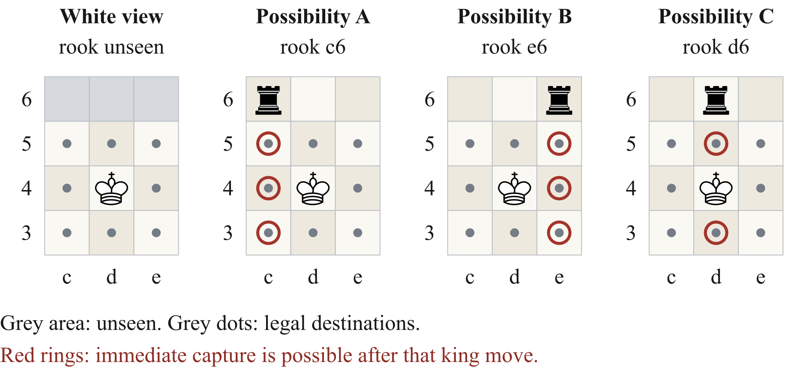
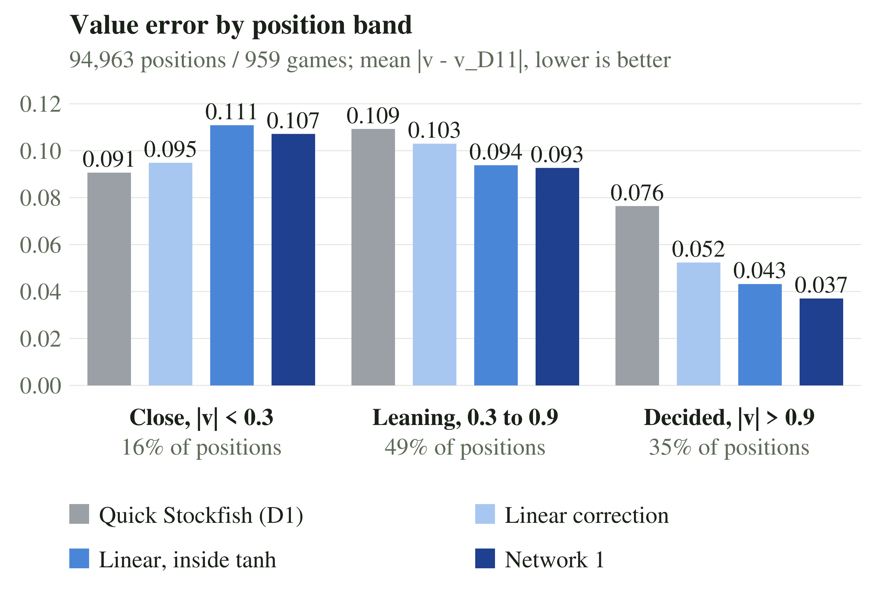

# Fog of War Chess

Search Prototypes and Learned Leaf Evaluation

CS4246/CS5446 Reinforcement Learning and Sequential Decision Making

National University of Singapore School of Computing

Semester 1 AY2026/27

11 November 2026

DING Chiyu; PEI Shengxin; QUEK Hongqiang Colin; Kuah Jun Hong Bryan; WANG Zhijian; LIN Tzu-Chun.

---

## Abstract

We study whether better leaf values improve Fog of War chess decisions. Our system separates private observations, belief tracking, search and replaceable evaluators. Network 1 reduces development-set error against Stockfish depth 11 from 0.095 to 0.076, without established move-selection improvement. Linear corrections recover much of this gain; outcome-trained models instead better predict the practice policy's results. Neither Network 1 nor linear correction establishes a score improvement in an archived 1,400-attempt one-ply batch. A later search batch finishes 93 of 100 attempts; Network 1 scores 46.59% on 44 clean colour pairs (95% interval 36.36%–56.82%). These results distinguish prediction, control, computation and completion reliability. Our uniformly sampled feasible histories are approximations, not calibrated posteriors or a complete reproduction of published Obscuro strength.

## 1 Introduction

Fog of War chess combines strategic interaction with hidden information: players see their own pieces and reachable squares, and moves change both the position and future information. In Figure 1, White's king on d4 can be captured after a step left if the hidden rook is on c6, or right if it is on e6. A rook on d6 threatens the remaining destinations. All three selected histories give White the same observations and eight legal moves.

**Figure 1.** Replay-checked possibilities, not a complete posterior. The crop shows files c-e and ranks 3-6; Black's king at a8 is omitted. Grey dots mark legal destinations and red rings permit immediate capture. Check does not restrict moves [1].

Zhang and Sandholm's knowledge-limited subgame solving [2] and later Obscuro system [3] motivate our prototypes. Their published playing strength does not transfer to our selected mechanisms. We contribute rules/interfaces, tracking and search prototypes, evaluators and audited match records.

Our questions are: RQ1, does a learned correction to a fast engine improve value accuracy and move selection? RQ2, how do training targets and other belief hypotheses affect predictions? RQ3, does changing the evaluator improve game score under a fixed outer planner? The one-ply and later search experiments test different planners and remain separate.

## 2 Decision problem and background

### 2.1 States, observations, histories and beliefs

We model a sequential zero-sum game with terminal utility +1/0/-1 for win/draw/loss. An information set groups histories indistinguishable from a player's private evidence; its strategy must use the same action distribution throughout that set [4].

The referee state includes pieces, side to move, castling/en-passant rights, counters and repetition history. An observation contains visible squares and their pieces or explicit emptiness, side to move, ply, legal-action feedback, own-piece capture notice and terminal outcome. Unseen squares are unknown, not empty; the current Pair A adapter hides the halfmove clock. Legal actions are evidence, not merely an output constraint.

A private history records one's observations after every ply and one's own actions, excluding hidden opponent moves. Current observations or equal FENs can conceal different past evidence, repetition paths and opponent memories. Let H_i(e) denote histories consistent with private evidence e. This support specifies possibility; a posterior b_i(h | e) additionally requires a probability model. Our interface returns hypotheses with positive weights summing to one within the sample. Pair A can attach complete candidate paths; synthetic/rebuilt board hypotheses have weaker guarantees.

The archived one-ply planner maximizes weighted successor value from the root player's perspective. Independently valuing full boards can imply different future actions in indistinguishable states (strategy fusion), so it is a controlled baseline rather than a complete imperfect-information solution [5].

### 2.2 Relation to POMDP belief updates

The course's MDP formulation specifies state, action, transition, reward and policy [6]. Given transition model T and observation model O, POMDP filtering is b′(s′) = η O(o′ | s′, a) Σ_s T(s′ | s, a) b(s); primes denote the next step and η normalizes [7]. Prediction propagates prior mass; observation likelihood corrects it. Our observation function is deterministic, giving an indicator of matching feedback.

A fixed opponent policy, with enough hidden state to determine it, induces a single-player partially observable process. Strategic interaction is instead naturally an imperfect-information game or partially observable stochastic game [8]. If the opponent uses private memory, piece placement alone cannot specify that induced transition model.

Our trackers enumerate feasible successors, filter observations and sample uniformly, without estimating opponent action probabilities. Uniform feasible histories are not generally the posterior under uniform actions: different branching factors produce different path probabilities. Exact support enumeration therefore does not mean an exact posterior. Neither the latest view nor a feature tensor is automatically a sufficient Markov state.

### 2.3 Search and learned continuation values

Decision-time search uses approximate values at its frontier [9]. Knowledge-limited solving restricts local regions while accounting for continuation outside them [2]. Obscuro combines such constructions with predictive counterfactual regret minimization, growing trees and policy processing [3]. Our finite-tree PCFR+ prototypes update action preferences at information sets and retain regret/strategy statistics during growth. Auxiliary gadget games express boundary choices and values; errors there affect the strategy even if local solving converges.

DeepStack and ReBeL motivate learned continuation values [10, 11], without transferring their guarantees to our sampled trees or full-board labels. Learning prediction and improving control are distinct tasks [12].

## 3 System and implementation

The referee owns the actual hidden board; agents receive private observations and own actions [13]. Online evaluators see inferred hypothetical boards, never the referee's hidden position. Offline label generation and post-game diagnostics use separate complete-position records. Visibility includes own squares and pseudo-legal destinations, ignoring check. Pawn diagonals reveal capturable targets; available en passant reveals target and pawn. Blocked pawn-forward squares remain hidden unless another piece sees them. Both players receive views after each ply; only the side to move receives legal actions.

**Figure 2.** Private evidence feeds tracking and decision making; an evaluator scores the frontier. Both planners share this boundary, but an evaluator swap does not equalise computation [13, 14].

Fog rules allow king capture and remove king-safety restrictions. Rule-decided values precede engine/network calls. Fixtures check specified visibility, castling, en-passant and draw cases, not every external implementation.

Pair A starts from the public position, applies known own actions or enumerates possible opponent actions, regenerates private feedback and retains matching successors. Candidate paths preserve history distinctions. Untruncated completed updates enumerate consistent support; output sampling alone does not bound internal growth. Search groups private histories into information sets, applies PCFR+ and expands continuations. Optional sampled subgame mode adds bounded reuse and approximate knowledge boundaries; full-history closure and numerical ancestor-gadget payment transfer remain limitations [13]. The later batch selects uniform-growth anytime search, not all optional mechanisms.

Its bounded-history policy uniformly prunes completed support to 8192 paths. If later evidence eliminates these, it retries bounded replay from the entire private observation/own-action stream, without actual hidden moves. Pruning can remove the true path and recovery can fail; the post-update cap is not a hard transient-memory bound [15].

The older one-ply batch instead uses Pair B's 256-particle tracker and eight output hypotheses. It merges board/repetition-equivalent candidates. Reconstruction relocates hidden pieces to fit current feedback, without certifying the complete private past; terminal recovery can relax result matching. Synthetic training alternatives are different again: hidden pieces are relocated while preserving the generating observation/actions, without requiring a legal complete path.

The shared encoder has 32 planes: 12 piece, four visibility, seven belief-summary, three context and six rule-state planes. Occupancy marginals sum sample weights; they are not a complete joint posterior. This representation does not preserve all private history or prove Markov sufficiency. Network 1 uses 19 board planes plus D1 score; the belief network uses 32 planes [14].

Historical experiments retain their measured rules/source [13, 16]. Tests cover retained solver state, failed expansions and budget/fallback accounting. Budgets are cooperative, and pilots expose long-history failures [17]; Section 6.5 reports later full-game evidence.

## 4 Learned leaf evaluation

### 4.1 Data and targets

Quick/careful Stockfish mean depths 1/11 of Stockfish 19, differing from the source papers' versions. Values use the acting-player perspective in [-1, 1]: tanh(c/600) for centipawns c, and ±1 for forced mate [14].

Solver labels were unavailable at generation time. We sampled four parents from each of 8,000 ordinary-chess practice games mixing Stockfish and random moves. MultiPV scores child moves together; Fog-rule checks override rule-decided positions.

A hash of game identity assigns 80% of games to training, 10% to validation and 10% to a sealed test bucket. The reported check set is a separate generation with a different seed: 959 games, 3,818 decisions and 94,963 eligible children after excluding rule-decided children. It also helped compare three Network 1 candidates, so the reported measurements are development results, not a sealed-test estimate [14].

### 4.2 Evaluators and learning targets

Piece values use conventional material weights 1, 3, 3, 5 and 9 as a simple floor. The linear correction adds a ridge-regression adjustment from 1,217 board features to quick Stockfish's value v1. A second parameterization keeps the prediction bounded: v = tanh(atanh(clip(v1)) + w·x + b), with the input clipped inside (-1, 1). Network 1 replaces the linear adjustment with a convolutional network of approximately 521,000 parameters. These models learn to match careful Stockfish by regression. They still require quick Stockfish, so their inference cost is additional to the engine call [14].

The 562,000-parameter belief network combines board embeddings with weighted belief context. Its architecture can vary a board's prediction with context, but practice labels are each board's belief-independent careful-Stockfish value. Synthetic candidates have the limitations in Section 3 [14].

We also train the bounded linear model on game outcomes. Monte Carlo (MC) uses the final result as its target. TD(0) bootstraps from the next state's estimate; because values follow the side to move, an ordinary nonterminal one-step target changes sign. TD(λ), with λ = 0.8, combines returns over different horizons. These are fitted prediction experiments using recorded trajectories, with semi-gradient targets and up to 15 TD rounds. They do not implement an online policy-improvement loop [12, 18].

## 5 Evaluation method

### 5.1 Offline metrics

Mean absolute error measures agreement with careful Stockfish. Same top move allows teacher ties; value lost is best eligible sibling teacher value minus the chosen move's teacher value. Evaluator ties use UCI order [14]. Paired differences use 2,000 bootstrap resamples of whole games to preserve within-game dependence. MC/TD also measure final-outcome MSE on a different trajectory population, stated in Table 2 [18].

### 5.2 Archived one-ply matches

Each candidate faces quick Stockfish on 100 random openings of two to eight plies, repeated with colours swapped. Win/draw/loss scores are 1/0.5/0; averages use complete colour pairs. We retain the archive's pair-bootstrap and approximate Wilson intervals. This protocol counts a 200-ply cap as a draw [16, 19].

Evaluator agents share one-ply planning, particle and hypothesis counts; random selects actions directly. Total work differs. Decision latency excludes tracking. Stockfish uses one thread, 16 MB hash, clears between games and retains state within games; its 60-second call watchdog is not an equal-time move budget.

The 26–27 October M5 Pro Mac batch uses Apple-GPU networks and source a5c5fb6 with stand-in rules. It predates no-move-draw/en-passant-repetition changes. No no-move endings occurred, but child values need not match later rules. Its seven comparisons remain separate from later games [16, 19].

### 5.3 Later search comparison

Pair C schedules 50 colour pairs (seeds 1001–1050), Network 1 versus D1 inside uniform-growth anytime search. Both use four hypotheses, depth 1 growing to at most 2, 16 solver rounds, 4096 nodes and 128 evaluator-call caps. Search allows five cooperative seconds; bounded-history tracking separately allows 60 seconds and eight replays. Equal caps imply neither equal work/reached depth nor a hard whole-turn deadline. The 200-ply diagnostic cap is unscored; only jointly clean terminal pairs contribute to score, while failures remain separate [20].

Runtime aaa000a uses native tracking, Stockfish 19 (one thread, 16 MiB hash) and net1-v2/best.pt on an RTX 5070 Ti Laptop GPU; tracking/engines use CPU. The archive pins code, configs, checkpoint, engine and native-library identities [20].

## 6 Results

### 6.1 Better value estimates do not establish better moves

**Table 1.** Development check results against careful Stockfish on 94,963 eligible children from 3,818 decisions in 959 games. Cost is median CPU time to evaluate a parent's children, measured separately on 300 sampled parent positions [14].

| Evaluator | Value error | Same top move | Value lost | ms per parent |
|---|---|---|---|---|
| Piece values | 0.336 | 27.7% | 0.2108 | 0.6 |
| Quick Stockfish | 0.095 | 42.9% | 0.0355 | 1.4 |
| Linear correction | 0.084 | 41.5% | 0.0346 | 1.7 |
| Linear inside tanh | 0.079 | 43.5% | 0.0348 | not timed |
| Network 1 | 0.076 | 42.4% | 0.0352 | 12.2 |

Network 1 reduces value error by about 20%. Its paired difference from quick Stockfish is -0.019, with a 95% interval [-0.021, -0.018]. The value-lost difference is -0.0003 [-0.0017, +0.0011]. That interval includes zero, so improved move selection is not established; statistical equivalence is not established either.

**Figure 3.** Value error on the development check set, grouped by careful Stockfish's assessment. Learned corrections improve errors in positions that already favour one side, but lose accuracy in close positions. The original analysis and bin definitions are retained in the evaluator archive [14].

Errors in decided positions may not change actions, whereas small errors in close positions can reverse rankings. Figure 3 suggests this explanation, but a targeted ablation is needed for causality.

Linear correction captures 56% of Network 1's error reduction, or 83% with bounded parameterization. Network 1 costs nine times D1 on CPU; Apple-GPU latency is 4.4 ms per parent, still three times D1.

### 6.2 The target determines what the value learns

Distillation fits 638,451 child rows from 6,414 training games. MC/TD drop 175 unfinished training games and use 722,500 trajectory positions from 6,239 finished games. Thus the target and training-row distribution both change. MC and TD never receive careful Stockfish's values [18].

**Table 2.** The same bounded linear model trained on different targets. Teacher metrics use the Table 1 population. Outcome error uses 106,971 trajectory positions from 929 finished check games, after excluding 32 unfinished games from 961 replayed games [18].

| Training target | Value error | Outcome MSE | Same top move | Value lost |
|---|---|---|---|---|
| Careful Stockfish | 0.079 | 0.513 | 43.5% | 0.0348 |
| Game result with MC | 0.217 | 0.481 | 38.6% | 0.0505 |
| TD(0) | 0.185 | 0.476 | 42.1% | 0.0370 |
| TD(λ) with λ = 0.8 | 0.208 | 0.476 | 41.5% | 0.0415 |
| Quick Stockfish without learning | 0.095 | 0.497 | 42.9% | 0.0355 |

Outcome-trained models predict the practice games' results better than distillation, while agreeing less with the stronger engine and losing more teacher value through their selected moves. TD(0)'s outcome MSE is lower than MC's by 0.0053 [0.0010, 0.0097]. The data describe how a weak, partly random policy converts positions into outcomes. Predicting that policy's returns is a different task from approximating stronger continuation play. Better performance on one target need not transfer to the other.

Both TD methods reach 15 rounds. A 40-round diagnostic barely changes outcome MSE and worsens teacher error; the cap alone does not explain the gap. This dataset/model result does not establish general inferiority of outcome-based RL [18].

### 6.3 Belief context improves prediction under restricted labels

On 3,818 synthetic check beliefs, the belief network reduces board error from quick Stockfish's 0.080 to 0.074 and weighted-belief error from 0.055 to 0.047. The latter difference is -0.008 [-0.009, -0.007], resampling the 959 source games. Across five training seeds, mean board error is 0.0734 with context and 0.0762 without it; every seed improves [14].

Each board's target is belief-independent. Context can denoise predictions without learning information's strategic value: different beliefs may require different strategies despite the same board label. Establishing strategic value needs information-sensitive labels and action comparisons.

### 6.4 Game outcomes under a common outer planner

**Table 3.** Separate comparisons against quick Stockfish. Each row schedules 200 games. Scores and intervals use complete colour pairs: 100 per row, except random with 99. W/D/L includes all finished games, including random's unpaired survivor. Cost is candidate median decision latency, excluding tracking [16, 19].

| Evaluator | Score | Bootstrap 95% | Wilson 95% | W/D/L | ms per move |
|---|---|---|---|---|---|
| Quick Stockfish | 0.520 | 0.455-0.588 | 0.423-0.615 | 103/2/95 | 11.1 |
| Random moves | 0.000 | withheld | 0.000-0.037 | 0/0/199 | 0.005 |
| Piece values | 0.048 | 0.023-0.078 | 0.020-0.108 | 9/1/190 | 4.3 |
| Linear correction | 0.513 | 0.455-0.573 | 0.416-0.608 | 98/9/93 | 14.2 |
| Network 1 | 0.515 | 0.448-0.585 | 0.418-0.611 | 100/6/94 | 36.1 |
| Belief network | 0.563 | 0.495-0.630 | 0.465-0.656 | 111/3/86 | 149.8 |
| Careful Stockfish | 0.585 | 0.513-0.660 | 0.487-0.677 | 114/6/80 | 2,452 |

There are 1,399 finished games and 699 complete colour pairs. One random-row game failed because quick Stockfish's tracker found no board consistent with its observations. Its surviving partner remains in W/D/L but is excluded from paired estimates. Random's bootstrap is withheld because every complete pair scores zero. Six draws reached the 200-ply cap: two linear and four careful-Stockfish games. All other draws were repetitions.

Random/material controls score poorly and self-play includes 0.5. Network 1/linear gains are unestablished. Belief-network intervals include 0.5. Careful Stockfish's bootstrap interval narrowly excludes 0.5, but Wilson includes it and seven-comparison adjustment removes the nominal finding. These separate matches against D1 are not a head-to-head ranking.

Network 1, belief network and D11 take respectively three, thirteen and 220 times D1's median decision time. The belief network receives singleton hypotheses, so this row does not test whole-belief context. An independent audit recomputed outcomes, intervals, timings and hashes without rerunning games [16].

### 6.5 Later search results and completion failures

All 100 planned games were attempted: 93 reached a terminal result and seven failed, with none capped, missing or unplayed. Failures affected six pairs, leaving 44 clean pairs (88 games). On those pairs, Network 1 recorded 41 wins, 47 losses and no draws: a paired score of 46.59%, with a whole-pair bootstrap 95% interval of 36.36%–56.82%. The analysis uses 20,000 whole-pair resamples. It establishes neither a Network 1 advantage nor statistical equivalence [20].

Four failures report no consistent full path after bounded-history replay, two exhaust the tracker update allowance, and one exceeds the pruning allowance. The excluded pair seeds are 1002, 1031, 1032, 1034, 1036 and 1043. Outcomes from surviving partners are excluded from the paired score. The estimate is conditional on joint clean completion and cannot be generalized to all scheduled seeds. Failed attempts remain evidence about system reliability. Opening/readiness checks on seeds 17 and 18 are not pooled into this batch [20].

This tests evaluator replacement inside sampled search, not ZS21 versus Obscuro, PCFR+ versus one-ply, or optional gadget contributions. Table 3 uses a different planner.

## 7 Discussion and limitations

Distillation predicts a full-board teacher; MC/TD predict practice-policy returns; strategic hidden-information values must also reflect information sets and future decisions. Prediction gains need not improve control [9, 12]. RQ1 finds better teacher agreement without established action gains; RQ2 exposes target/context limitations; RQ3 establishes no Network 1 score gain in either planner.

Generalization is limited by ordinary-chess data, synthetic beliefs, development-set selection, unused sealed tests and approximate teacher values. Game splits do not exclude all transpositions. MC/TD change rows as well as targets and retain some endings inconsistent with current rules [18].

The old batch uses older rules, one opponent, unequal compute and singleton belief-network inputs. Later results condition on joint completion. Neither tracker has established posterior calibration, coverage or true-path retention; consistent samples do not guarantee these. Sampled knowledge boundaries and cooperative budgets limit search. Local solver diagnostics do not establish whole-game exploitability or published Obscuro strength.

Next steps are equal whole-turn-resource comparisons, actual-work/depth reporting, tracker-quality measurements and information-sensitive solver labels. The project does not establish a complete self-improving learning system.

## 8 Responsible practice and team contributions

The referee-player boundary prevents unfair access to hidden true-board data. Separate offline generation and online inference paths help enforce it. Archiving configurations, seeds and failed attempts supports reproducibility; reporting null findings and unequal costs avoids overstating strength. No human study was conducted. Future human matches should identify the bot and obtain consent.

Work was divided across search, learning and evaluation. Ding Chiyu developed rules and observation interfaces, PCFR+/gadget search prototypes, growth and diagnostics, and later evaluation integration with bounded-history replay recovery. Pei Shengxin's workstream covers belief tracking and ZS21. Colin developed evaluators, practice-data training, the particle bot, match runner and Fog Lab, and operated the batch. Bryan developed the linear baseline and state-preserving expansion API, audited the games, and contributed integration checks, reviews and reporting. Wang Zhijian's workstream covers Pair C evaluation and provenance. Lin Tzu-Chun's proposal responsibility covers environment and belief representation. Shared interfaces and reviews connect these workstreams [21].

Bryan reported GitHub Copilot and Codex assistance for inspection, probes, artifact checks and earlier report drafting. Ding used Codex for implementation and validation, and for this report's clarification, source checks and document regeneration. The proposal disclosed Claude-assisted drafting. The team supplied design, implementation, experiments, archive review and interpretation. AI-generated text and code remain the authors' responsibility; they are not experimental evidence.

## 9 Conclusion

More accurate full-board values need not improve hidden-information decisions. Network 1 lowers teacher error about 20% but has inconclusive action/game-score gains at higher cost; linear corrections recover much of the regression gain. MC/TD better predict the practice policy instead. The later search score of 46.59% on 44 clean pairs establishes no advantage; seven failures prevent an unconditional claim. Evaluation must distinguish target accuracy, belief approximation, action quality, computation and completion reliability.

## References

1. CS5446_project contributors. Replay-checked hidden-rook example. [Internet]. 2026 [cited 2026 Nov 8]. Three observation-identical histories and 24 checked move/state consequences. Available from: [https://github.com/Mr-Teal/CS5446_project/blob/03a01e8d97317b36e63f77a5c67359c9c5b3742f/docs/drafts/presentation-assets/hidden-rook-example.json](https://github.com/Mr-Teal/CS5446_project/blob/03a01e8d97317b36e63f77a5c67359c9c5b3742f/docs/drafts/presentation-assets/hidden-rook-example.json).

2. Zhang BH, Sandholm T. Subgame solving without common knowledge. arXiv:2106.06068v2 [Internet]. 2021 Dec 3 [cited 2026 Nov 8]. Available from: [https://arxiv.org/abs/2106.06068v2](https://arxiv.org/abs/2106.06068v2).

3. Zhang BH, Sandholm T. General search techniques without common knowledge for imperfect-information games, and application to superhuman Fog of War chess. arXiv:2506.01242v2 [Internet]. 2026 Feb 28 [cited 2026 Nov 8]. Available from: [https://arxiv.org/abs/2506.01242v2](https://arxiv.org/abs/2506.01242v2).

4. National University of Singapore School of Computing. Game theory. CS4246/CS5446 course slides. Version 4.0. Semester 1, AY2026/27.

5. Frank I, Basin D. Search in games with incomplete information: a case study using Bridge card play. Artif Intell. 1998;100(1-2):87-123.

6. National University of Singapore School of Computing. Sequential decision making under uncertainty. CS4246/CS5446 course slides. Version 1.0. Semester 1, AY2026/27.

7. Kaelbling LP, Littman ML, Cassandra AR. Planning and acting in partially observable stochastic domains. Artif Intell. 1998;101(1-2):99-134. Available from: [https://www.cassandra.org/arc/papers/aij98.pdf](https://www.cassandra.org/arc/papers/aij98.pdf).

8. Hansen EA, Bernstein DS, Zilberstein S. Dynamic programming for partially observable stochastic games. In: Proceedings of AAAI-04. 2004. p. 709-15. Available from: [https://cdn.aaai.org/AAAI/2004/AAAI04-112.pdf](https://cdn.aaai.org/AAAI/2004/AAAI04-112.pdf).

9. National University of Singapore School of Computing. Guided sequential decision making: decision-time and demonstration-based planning. CS4246/CS5446 course slides. Version 1.0. Semester 1, AY2026/27.

10. Moravčík M, Schmid M, Burch N, Lisý V, Morrill D, Bard N, et al. DeepStack: expert-level artificial intelligence in heads-up no-limit poker. Science. 2017;356(6337):508-13. Available from: [doi:10.1126/science.aam6960](https://doi.org/10.1126/science.aam6960).

11. Brown N, Bakhtin A, Lerer A, Gong Q. Combining deep reinforcement learning and search for imperfect-information games. In: Advances in Neural Information Processing Systems 33; 2020. Available from: [https://arxiv.org/abs/2007.13544](https://arxiv.org/abs/2007.13544).

12. National University of Singapore School of Computing. Reinforcement learning model-free techniques. CS4246/CS5446 course slides. Version 4.1. Semester 1, AY2026/27.

13. CS5446_project contributors. Shared interfaces and sampled search implementation. [software and documentation on the Internet]. 2026 [cited 2026 Nov 8]. Integrated snapshot 3335723. Available from: [https://github.com/Mr-Teal/CS5446_project/tree/3335723852ad59ccbe5e999dbe0ce2773f7e56d0](https://github.com/Mr-Teal/CS5446_project/tree/3335723852ad59ccbe5e999dbe0ce2773f7e56d0).

14. Quek HC, Kuah JHB, CS5446_project contributors. Leaf evaluators and practice-data results. [Internet]. 2026 [cited 2026 Nov 8]. Snapshot 3335723; linked data manifests, checkpoints and ablations. Available from: [https://github.com/Mr-Teal/CS5446_project/blob/3335723852ad59ccbe5e999dbe0ce2773f7e56d0/pair_b/README.md](https://github.com/Mr-Teal/CS5446_project/blob/3335723852ad59ccbe5e999dbe0ce2773f7e56d0/pair_b/README.md).

15. CS5446_project contributors. Bounded history inference with private-stream replay recovery. [software on the Internet]. 2026 [cited 2026 Nov 11]. Measured runtime aaa000a. Available from: [https://github.com/Mr-Teal/CS5446_project/blob/aaa000a034ae5275afe981402891596e660312a4/pair_a_prep/bounded_tracking.py](https://github.com/Mr-Teal/CS5446_project/blob/aaa000a034ae5275afe981402891596e660312a4/pair_a_prep/bounded_tracking.py).

16. Kuah JHB, CS5446_project contributors. Evaluation methods and batch validation. [Internet]. 2026 Oct 28 [cited 2026 Nov 8]. Revision 7c292af. Archive recomputation and historical rule boundaries. Available from: [https://github.com/Mr-Teal/CS5446_project/blob/7c292af5881b8c81e4ffccb7300de21650c9c0ad/pair_b/docs/evaluation-methods-draft.md](https://github.com/Mr-Teal/CS5446_project/blob/7c292af5881b8c81e4ffccb7300de21650c9c0ad/pair_b/docs/evaluation-methods-draft.md).

17. CS5446_project contributors. Search verification and integration evidence. [Internet]. 2026 [cited 2026 Nov 8]. Historical source identities and pilot limitations. Available from: [https://github.com/Mr-Teal/CS5446_project/blob/bryankuah/report-presentation-drafts/docs/drafts/report-evidence-notes.md](https://github.com/Mr-Teal/CS5446_project/blob/bryankuah/report-presentation-drafts/docs/drafts/report-evidence-notes.md).

18. CS5446_project contributors. Monte Carlo and temporal-difference target comparison. [Internet]. 2026 [cited 2026 Nov 8]. Revision 1db35d6. Available from: [https://github.com/Mr-Teal/CS5446_project/blob/1db35d68638d52353381d13de20addfea58a4d99/pair_b/experiments/mc_td/RESULTS.md](https://github.com/Mr-Teal/CS5446_project/blob/1db35d68638d52353381d13de20addfea58a4d99/pair_b/experiments/mc_td/RESULTS.md).

19. Quek HC, CS5446_project contributors. Seven-row match batch. [dataset on the Internet]. 2026 Oct 27 [cited 2026 Nov 8]. Execution a5c5fb6; reviewed archive 5e9393a. Available from: [https://github.com/Mr-Teal/CS5446_project/tree/5e9393ab8537088e8ea6542ce21e11f42218ee15/pair_b/experiments/matches/batch-2026-10-27](https://github.com/Mr-Teal/CS5446_project/tree/5e9393ab8537088e8ea6542ce21e11f42218ee15/pair_b/experiments/matches/batch-2026-10-27).

20. CS5446_project contributors. Network 1 vs Stockfish D1 evaluation. [dataset on the Internet]. 2026 Nov 10 [cited 2026 Nov 11]. 100 attempted games; pinned returned archive. Available from: [https://github.com/Mr-Teal/CS5446_project/blob/8c7baf758e40f8a23c09b273903cff0aee38d2cb/pair_c/evaluation_20261110/README.md](https://github.com/Mr-Teal/CS5446_project/blob/8c7baf758e40f8a23c09b273903cff0aee38d2cb/pair_c/evaluation_20261110/README.md).

21. CS5446_project team. Project contribution records. [Internet]. 2026 [cited 2026 Nov 8]. Contribution statements and proposal work allocation; see report evidence notes. Available from: [https://github.com/Mr-Teal/CS5446_project/pull/33](https://github.com/Mr-Teal/CS5446_project/pull/33).
