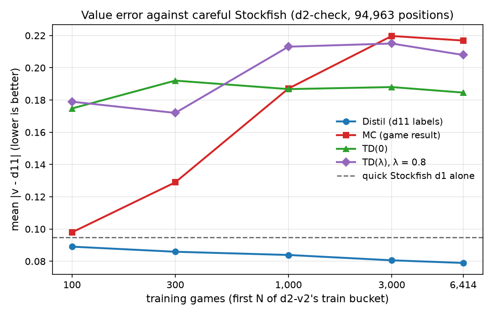
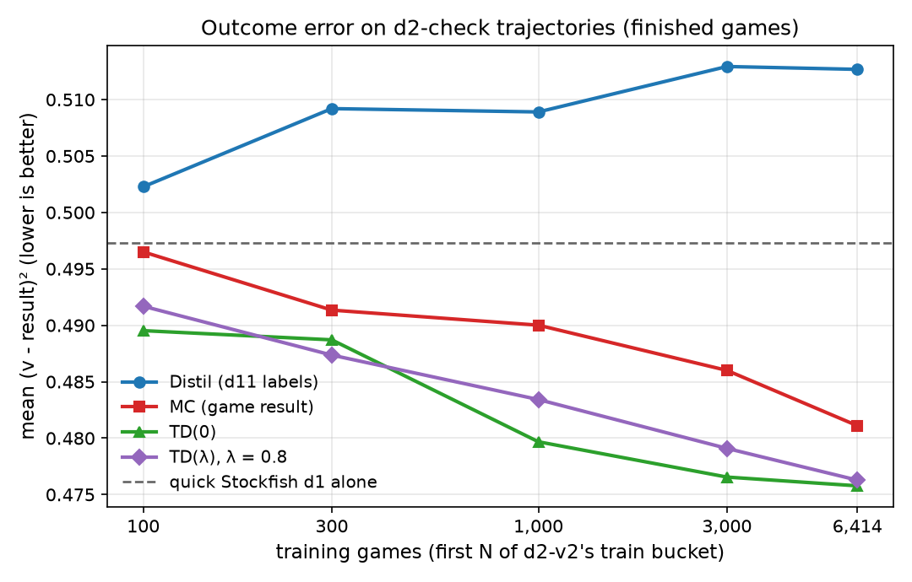

# MC and TD value learning against distilling careful Stockfish

The model-free prediction experiment for the D8 report. Every number here is in `results.json`.

## Setup

- **Data.** The model is fitted on d2-v2's train bucket (6,414 games). Its val bucket (776 games) chooses α and stops TD. Scores come from d2-check's train bucket, the same rows as the report's tables.
- **Trajectories.** Each game was replayed from its seed with `pairb.d2.play_game` (Stockfish 19, 1 thread, 16 MB hash). All 8,151 replays match `games.jsonl` on plies, result, termination, eps and opening plies. All 32,367 stored parent FENs and all 810,179 stored d1 values also come out exactly. A position's d1 is its move's score in a MultiPV depth-1 call at the position before it, which is how the labels were made.
- **Model.** Every method uses the same model: v = tanh(atanh(clip(d1, 0.999)) + x·w + b) on the 1,217 inputs of `pairb.linear.features`, from the side to move's view. The loss is squared error in value space plus α‖w‖², fitted by damped Gauss-Newton starting from w = 0.
- **Targets.** Distil learns d11 from the D2 records, which are the children of 4 parents per game. Depth 11 on all 812,868 train and val trajectory positions would take hours. MC learns the game's result. TD(0) learns −v(s<sub>t+1</sub>), with the result at the last position. TD(λ = 0.8) learns the λ-return built from the same one-step targets. Both TD methods use fitted value iteration with semi-gradient targets. They stop when validation error stops improving, with a cap of 15 rounds.
- **Choosing α.** α comes from 10⁻⁵ to 10¹, tried upward until validation error rises. Distil is validated against d11. MC and TD are validated against the game result, so they never see careful Stockfish.
- **Unfinished games** are dropped from MC and TD. That is 175 of 6,414 train games, 24 of 776 val games and 32 of 961 evaluation games.
- **Scores.** Value error is mean |v − d11| over 94,963 positions from 959 games. Move choice is scored on their 3,818 decisions. Outcome error is mean (v − result)² over 106,971 positions from the 929 finished d2-check games.

## Results at full data

Full data is 6,414 games: 638,451 Distil rows, and 722,500 trajectory rows from 6,239 finished games.

| Method | α | TD rounds (best / run) | Value error | Value error, played moves | Outcome error | Top-1 | Value lost |
|---|---|---|---|---|---|---|---|
| Distil (d11 labels) | 1e-5 | - | **0.0790** | **0.0786** | 0.5127 | **0.435** | **0.0348** |
| MC (game result) | 1e-5 | - | 0.2169 | 0.1861 | 0.4811 | 0.386 | 0.0505 |
| TD(0) | 1e-4 | 15 / 15 (cap) | 0.1846 | 0.1586 | **0.4758** | 0.421 | 0.0370 |
| TD(λ), λ = 0.8 | 1e-5 | 15 / 15 (cap) | 0.2079 | 0.1754 | 0.4763 | 0.415 | 0.0415 |
| Quick Stockfish d1 alone | - | - | 0.0949 | - | 0.4973 | 0.429 | 0.0355 |
| v = 0 | - | - | - | - | 0.8316 | - | - |

"Played moves" means the 3,755 evaluation positions that the games actually reached (the played child of each parent), so it is the distribution MC and TD learn from. Distil reproduces the tanh comparison: α 1e-5, value error 0.0790, top-1 0.435.

## Learning curves





| Games | Distil | MC | TD(0) | TD(λ) |
|---|---|---|---|---|
| 100 | 0.0891 / 0.5023 | 0.0979 / 0.4965 | 0.1748 / 0.4895 | 0.1790 / 0.4917 |
| 300 | 0.0859 / 0.5092 | 0.1290 / 0.4913 | 0.1920 / 0.4887 | 0.1720 / 0.4874 |
| 1,000 | 0.0839 / 0.5089 | 0.1871 / 0.4900 | 0.1868 / 0.4797 | 0.2131 / 0.4834 |
| 3,000 | 0.0806 / 0.5129 | 0.2197 / 0.4860 | 0.1880 / 0.4765 | 0.2150 / 0.4791 |
| 6,414 | 0.0790 / 0.5127 | 0.2169 / 0.4811 | 0.1846 / 0.4758 | 0.2079 / 0.4763 |

Each cell is value error / outcome error. MC and TD use the finished games among the first N, which is 97, 296, 972, 2,909 and 6,239 games. For the α it selected, TD(0) reached the 15-round cap at every size from 1,000 games up, and TD(λ) at every size except 1,000.

## Intervals

These are at full data, from `pairb.metrics.paired_difference` (and `paired_regret_difference` for value lost). Each uses 2,000 resamples of whole games with seed 0. Each row is a − b, and a negative value means a does better.

| Difference | Value error | Outcome error | Value lost |
|---|---|---|---|
| MC − TD(0) | +0.0323 [+0.0295, +0.0351] | +0.0053 [+0.0010, +0.0097] | +0.0135 [+0.0105, +0.0164] |
| TD(λ) − MC | −0.0089 [−0.0112, −0.0067] | −0.0048 [−0.0081, −0.0017] | −0.0090 [−0.0115, −0.0063] |
| Distil − MC | −0.1379 [−0.1426, −0.1334] | +0.0316 [+0.0199, +0.0434] | −0.0157 [−0.0191, −0.0125] |
| Distil − TD(0) | −0.1056 [−0.1090, −0.1025] | +0.0369 [+0.0275, +0.0468] | −0.0022 [−0.0044, −0.0002] |
| Distil − TD(λ) | −0.1290 [−0.1327, −0.1253] | +0.0364 [+0.0256, +0.0477] | −0.0068 [−0.0092, −0.0044] |
| TD(λ) − TD(0) (extra) | +0.0233 [+0.0215, +0.0251] | +0.0005 [−0.0023, +0.0031] | +0.0045 [+0.0027, +0.0064] |

## What it means for the report

Learning the leaf from game outcomes, on the same inputs and model, leaves its values 2.3 to 2.7 times further from careful Stockfish than distilling it (0.185 to 0.217 against 0.079), and further than quick Stockfish alone (0.095), on the positions the games reached as well as on all children. What MC and TD learn is how the practice self-play (Stockfish depth 1 plus 2 to 15% random moves) converts positions: they predict its results better than Distil (0.476 to 0.481 against 0.513), though most of that signal is already in d1 (0.497). They also choose moves worse (top-1 0.386 to 0.421 against 0.435). TD beats MC on outcome error at every training size, and at full data on all three scores; the expected catch-up by MC had not happened by 6,239 games. This supports distilling careful Stockfish: outcome targets would only pay off with a strong policy playing far more games than D2 has.

## Caveats

- **The TD round cap.** TD(0) hit the 15-round cap from 1,000 games up while still improving. Run to 40 rounds at full data (`td-rounds-diagnostic.json`), its validation error is lowest at round 25. There its outcome error is 0.4751 and its value error 0.212, and the value error keeps rising, to 0.231 by round 40. TD(λ) settles by round 35, at 0.4761 and 0.218. Lifting the cap barely changes outcome error and only worsens value error, so the conclusions stand.
- **Distil learns from different rows.** Distil's rows are every child of 4 parents per game, the same kind of rows as the evaluation set. MC and TD learn from the positions the games passed through. The played-moves column scores only positions the games reached, and the gap is as large there.
- **Grid edge at 100 games.** At 100 games, MC's validation picked the top of the α grid (10). Its weights shrink almost to zero, so it is d1 plus a small shift. A first run whose grid ended at 0.1 also picked its top value at 100 games, so the grid was widened and the whole run repeated (`run-1-narrow-grid-stopped.log`).
- **Grid edge at full data.** At full data, Distil, MC and TD(λ) picked the bottom of the grid (10⁻⁵), as the tanh comparison did for Distil. `alpha-edge-check.json` fits 10⁻⁶. That would win on validation for Distil and MC, but it moves their value error by at most 0.0006 and their outcome error by at most 0.0005. TD(λ) keeps 10⁻⁵.
- **Where the rules disagree with the stored ending.** 133 finished games are a forced draw under the fog rules one position before the end; their chains stop there, with value 0, which is also their result. 26 games end in an ordinary checkmate that the fog rules would not end (castling out of check, or the fifty-move count); they keep their stored result.
- **How trajectory d1 was scored.** Trajectory d1 sends Stockfish the game history, as `children_scores` did when D2 was made on 16 Oct. Commit 305b94a changed it to send the position alone on 18 Oct. Matching the old call is what makes every stored d1 reproduce exactly.

## Files and commands

Run these from this folder (`pair_b/experiments/mc_td`) with the repo's venv Python and `PYTHONDONTWRITEBYTECODE=1`, with the D2 data folders in `pair_b/data/` as the README sets them up. They read the data and the repo only.

```bash
python replay_trajectories.py ../../data/d2-check cache/trajectories-d2-check-train.jsonl --splits train
python replay_trajectories.py ../../data/d2-v2 cache/trajectories-d2-v2-train-val.jsonl --splits train val
python check_reparam.py ../../data/d2-check ../tanh_linear/linear_tanh.py check-reparam.json
python mc_td.py ../../data/d2-v2 ../../data/d2-check cache/trajectories-d2-v2-train-val.jsonl cache/trajectories-d2-check-train.jsonl .
python td_rounds_diagnostic.py cache/trajectories-d2-v2-train-val.jsonl ../../data/d2-check cache/trajectories-d2-check-train.jsonl results.json td-rounds-diagnostic.json --rounds 40
python alpha_edge_check.py ../../data/d2-v2 ../../data/d2-check cache/trajectories-d2-v2-train-val.jsonl cache/trajectories-d2-check-train.jsonl alpha-edge-check.json
python assemble_results.py
<python with matplotlib> make_figures.py results.json .
```

- `mc_td.py` writes `results.json` and `models.npz`. `models.npz` holds the four full-data models as 1,217 weights plus b.
- `mc_td.py` fits a 750-column design that is exactly equivalent: it drops plane 12, merges the planes that are constant across the board, and leaves out squares that are always empty. `check-reparam.json` shows it reaches the same optimum as the 1,217-column fit, with predictions within 4e-7.
- The repo's venv has no matplotlib. The figures were drawn with matplotlib 3.11.2 in a separate Python 3.12 environment that reads only `results.json`.
- Total compute was about 27 minutes; `results.json` → `compute_seconds` has the breakdown.
